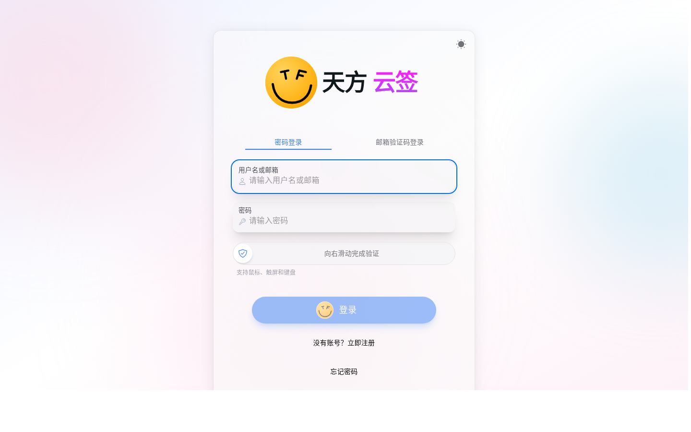

<a href="https://www.yunsign.net/"></a>

# 天方云签 · TFcloud（Go 版）

> 把重复的签到交给程序，把时间留给真正重要的事情。

面向个人的多平台、多任务、多账号自动签到系统。
后端由原版的 **PHP 8.4 + Webman + MySQL** 重写为 **Go 单二进制 + 内嵌 SQLite**，
前端 UI（React 19 + HeroUI + Tailwind）**样式与交互完全继承**，接口契约保持兼容。

[](https://github.com/ssdxftx/TFcloud/actions/workflows/docker-image.yml)
[](LICENSE)
[](https://go.dev/)
[](https://react.dev/)

<!-- badge 指向本仓库；fork 后把 ssdxftx 换成自己的用户名 -->

---

## 目录

- [一、它是什么](#一它是什么)
- [二、界面预览](#二界面预览)
- [三、与原版的差异](#三与原版的差异)
- [四、架构](#四架构)
- [五、部署教程](#五部署教程)
  - [5.1 前置要求](#51-前置要求)
  - [5.2 方式一：Docker Compose（推荐）](#52-方式一docker-compose推荐)
  - [5.3 方式二：直接拉现成镜像](#53-方式二直接拉现成镜像)
  - [5.4 方式三：裸机二进制 + systemd](#54-方式三裸机二进制--systemd)
  - [5.5 方式四：宝塔面板](#55-方式四宝塔面板)
  - [5.6 ARM / 群晖 / 软路由](#56-arm--群晖--软路由)
  - [5.7 反向代理与 HTTPS](#57-反向代理与-https)
  - [5.8 升级、备份、迁移、卸载](#58-升级备份迁移卸载)
- [六、安装向导](#六安装向导)
- [七、首次使用：接入平台账号](#七首次使用接入平台账号)
- [八、任务与调度](#八任务与调度)
- [九、邮件与通知](#九邮件与通知)
- [十、管理后台](#十管理后台)
- [十一、配置参考](#十一配置参考)
- [十二、命令行](#十二命令行)
- [十三、数据与备份](#十三数据与备份)
- [十四、性能与调优](#十四性能与调优)
- [十五、故障排查](#十五故障排查)
- [十六、安全建议](#十六安全建议)
- [十七、二次开发](#十七二次开发)
- [十八、从 PHP 版迁移](#十八从-php-版迁移)
- [十九、许可与免责](#十九许可与免责)

---

## 一、它是什么

一个自己部署、自己用的签到中心：把贴吧、B 站、网易云、爱奇艺、Zepp Life、天翼云盘、哔咔漫画、赛马娘、Yamibo、V2EX 这些
「每天点一下」的动作交给程序，按你指定的时间自动执行，失败自动重试，结果写进明细和日历。

**核心特性**

| 特性 | 说明 |
|---|---|
| 10 个平台插件 | 贴吧、哔哩哔哩、网易云音乐、爱奇艺、Zepp Life、天翼云盘、哔咔漫画、赛马娘、Yamibo、V2EX |
| 多账号多任务 | 一个用户可挂多个平台账号，每个账号独立计划 |
| 定时调度 | `auto`（按账号 ID 散列到 05:00–08:00 的随机分钟）或 `fixed`（自定 HH:MM） |
| 失败重试 | 普通任务最多 24 次，指数退避；贴吧「上游请求失败」持续补签直到成功 |
| 执行明细 | 每个贴吧、每个视频、每个直播间都是独立记录，可在页面实时看进度 |
| 凭据加密 | XChaCha20-Poly1305，数据库里只有密文；指纹用于去重 |
| B 站粉丝牌挂机 | 独立 Worker 进入直播间按服务端间隔发心跳，支持多房间 |
| 邮件通知 | 验证码、密码找回、每日签到汇总、管理员群发 |
| 管理后台 | 用户、平台账号、任务、审计日志、邮件、站点设置、版本检查 |
| 单文件部署 | 一个二进制 + 一个 `.db`，无 PHP、无 Composer、无 MySQL、无 Nginx 也能跑 |

**当前边界（诚实说明）**

- QQ 快捷登录 / 中转：接口保留但返回 `QQ_LOGIN_UNAVAILABLE`，中转协议尚未移植；
- 平台扫码 / 短信登录：未移植，`/platforms` 只下发已实现的方式（账号密码或 Cookie/BDUSS 导入）；
- 站内推送：支持企业微信机器人、Server酱、PushPlus、Bark，测试按钮会真实投递；
- 插件按原逻辑 1:1 移植，已在贴吧真机验证通过，其余平台建议先单次执行确认。

---

## 二、界面预览

| 首页 | 登录 |
|---|---|
|  |  |

> 深色模式、玻璃拟态、字体与动效均沿用原版设计，未做改动。

---

## 三、与原版的差异

| 维度 | 原版 | 本版 |
|---|---|---|
| 后端语言 | PHP 8.4 + Webman | **Go 1.21+（net/http + chi）** |
| 数据库 | MySQL 8（外置） | **SQLite（内嵌，WAL）** |
| 依赖 | PHP 扩展 + Composer + MySQL + Nginx | **无**（静态二进制） |
| 常驻进程 | 7 个 Workerman 进程 | 1 进程内 goroutine 池 |
| 账号配额 / 会员 | `users.quota`、`site.default_quota` | **已整条移除** |
| 启动到监听 | 秒级 | < 300ms |
| 空载内存 | 150–250MB | < 80MB |
| 二进制 | — | 17–22MB（含前端） |
| 前端 | React 19 + HeroUI | **完全一致**（仅安装页与构建输出路径改动） |

接口层保持兼容：统一信封 `{code, message, data, request_id}`、Cookie 会话（后端仍接受已有 Bearer Token）、
`X-Request-Id`、错误码与分页结构均未变，所以前端不需要改调用。

---

## 四、架构

```
┌────────────────────── 单进程 tfcloud ──────────────────────┐
│  chi router（90 条路由：API、健康检查与前端兜底）          │
│    ├ RequestID / Recover / CORS / InstallGuard             │
│    ├ AuthRequired / AdminRequired / RateLimit              │
│    └ handler → service（认证·账号·任务·邮件·后台·直播）    │
│                                                            │
│  Worker 池（goroutine）                                     │
│    ├ scheduler      30s 扫描到期账号，按日建任务             │
│    ├ sign-worker    N 个，UPDATE … RETURNING 原子领取        │
│    ├ tieba-retry    只领「上游请求失败」的贴吧任务           │
│    ├ live-worker    B 站粉丝牌挂机（进房 + 签名心跳）        │
│    ├ mail-worker    队列消费 + 指数退避重试                  │
│    └ maintenance    清理过期数据 / 恢复僵死任务 / WAL 截断   │
│                                                            │
│  SQLite：写连接池=1，读连接池=N，WAL + busy_timeout=5s      │
│  前端 dist 经 go:embed 打进二进制，SPA 回退到 index.html     │
└────────────────────────────────────────────────────────────┘
```

**三个关键设计**

1. **任务领取原子化**：原版「先 SELECT 再 UPDATE」存在重复执行窗口，
   这里用单条 `UPDATE ... WHERE id=(SELECT ... LIMIT 1) RETURNING id` 解决。
2. **SQLite 双连接池**：写池 1 连接、读池 N 连接，避免 WAL 下读写互锁；
   维护任务每小时 `wal_checkpoint(TRUNCATE)`，防止 WAL 无限增长。
3. **时间字段存 TEXT**：`YYYY-MM-DD HH:MM:SS.mmm` 与 MySQL 输出逐字符一致，
   字典序即时间序，接口与前端零改动。

---

## 五、部署教程

### 5.1 前置要求

| 方式 | 要求 |
|---|---|
| Docker（推荐） | Docker 20+ 与 Docker Compose v2；架构 amd64 / arm64 |
| 裸机 | Linux（amd64/arm64），无需任何运行时（静态二进制） |
| 源码构建 | Go 1.21+、Node 22+、pnpm 10+ |

服务器最低配置：**1 核 / 512MB 内存 / 200MB 磁盘**（SQLite 与日志都很轻）；推荐 1 核 1G。
系统时间要准确（签到时间依赖本地时区，容器默认 `TZ=Asia/Shanghai`）。

> **端口**：服务默认监听 `8787`，容器只发布到 `127.0.0.1`，对外由反向代理暴露。
> 建议全程使用 HTTPS —— 否则登录 Cookie 无法设置 Secure，也容易被中间人截获凭据。

---

### 5.2 方式一：Docker Compose（推荐）

#### ① 准备目录

```bash
mkdir -p /opt/tfcloud && cd /opt/tfcloud
# 把仓库放到这里（git clone 或 scp 上传）
git clone <你的仓库地址> .
```

目录里至少有：`Dockerfile`、`docker-compose.yml`、`docker-entrypoint.sh`、`cmd/`、`internal/`、`ui/`。

#### ② 按需调整 Compose

```yaml
services:
  tfcloud:
    build: .                      # 或者 image: ghcr.io/ssdxftx/tfcloud:latest
    container_name: tfcloud
    restart: unless-stopped
    ports:
      - "127.0.0.1:8787:8787"     # 只绑回环，由 Nginx/Caddy 对外
    environment:
      TZ: Asia/Shanghai
      TF_DATA_DIR: /data
      HTTP_ADDR: ":8787"
      SIGN_WORKER_COUNT: "2"       # 签到并发，按 CPU 调
      BILIBILI_LIVE_WORKER_COUNT: "2"
    volumes:
      - ./data:/data               # 所有数据都在这里
    healthcheck:
      test: ["CMD", "wget", "-qO-", "http://127.0.0.1:8787/health/ready"]
```

端口想换就改左边（例如 `"9000:8787"`），容器内始终是 8787。

#### ③ 启动

```bash
docker compose up -d --build
docker compose ps          # 等到 STATUS 变成 healthy
docker compose logs -f     # 首次启动会打印 tfcloud started
```

首次构建会编译前端与后端，通常 3–6 分钟；之后有缓存会快很多。

#### ④ 判断是否起来

```bash
curl -s http://127.0.0.1:8787/health/live    # {"status":"ok"}
curl -s http://127.0.0.1:8787/health/ready   # {"status":"ready","installed":false}
```

`installed:false` 表示还没安装，去浏览器打开 `http://服务器IP:8787/install`。

#### ⑤ 安装

见 [第六章 安装向导](#六安装向导)。

#### ⑥ 配反向代理 + HTTPS

见 [5.7](#57-反向代理与-https)。

#### ⑦ 日常运维命令

```bash
docker compose logs -f --tail=200              # 日志
docker compose restart                         # 重启
docker compose down                            # 停止（数据保留）
docker compose up -d --build                   # 更新代码后重建
docker exec -it tfcloud /app/tfcloud doctor    # 容器内自检
```

---

### 5.3 方式二：直接拉现成镜像

镜像由 GitHub Actions 自动构建，`linux/amd64` 与 `linux/arm64` 双架构：

```bash
docker run -d --name tfcloud --restart unless-stopped \
  -p 127.0.0.1:8787:8787 \
  -v /opt/tfcloud/data:/data \
  -e TZ=Asia/Shanghai \
  ghcr.io/ssdxftx/tfcloud:latest
```

| 标签 | 含义 |
|---|---|
| `latest` | 默认分支最新构建 |
| `v1.2.3` / `1.2` | 打 `v*` 标签时生成 |
| `sha-abc1234` | 某次提交 |

> 私有仓库拉取前先 `docker login ghcr.io -u <用户名> -p <TOKEN>`。

---

### 5.4 方式三：裸机二进制 + systemd

适合不想装 Docker 的机器，或者需要 1 核 512MB 跑满性能的场景。

#### ① 构建或获取二进制

```bash
# 在本地/其它机器上交叉编译
CGO_ENABLED=0 GOOS=linux GOARCH=amd64 \
  go build -trimpath -ldflags="-s -w" -o tfcloud ./cmd/tfcloud

# 传到服务器
scp tfcloud root@server:/usr/local/bin/tfcloud
chmod +x /usr/local/bin/tfcloud
```

也可以在有 Node 的机器上先 `make build`（会顺带构建前端并 embed 进二进制）。

#### ② 建用户与目录

```bash
useradd --system --home /var/lib/tfcloud --shell /usr/sbin/nologin tfcloud
install -d -o tfcloud -g tfcloud -m 750 /var/lib/tfcloud
install -d -o tfcloud -g tfcloud -m 750 /var/lib/tfcloud/uploads
```

#### ③ systemd 单元

`/etc/systemd/system/tfcloud.service`：

```ini
[Unit]
Description=TFcloud sign center
After=network-online.target
Wants=network-online.target

[Service]
Type=simple
User=tfcloud
Group=tfcloud
WorkingDirectory=/var/lib/tfcloud
Environment=TF_DATA_DIR=/var/lib/tfcloud
Environment=HTTP_ADDR=127.0.0.1:8787
Environment=TZ=Asia/Shanghai
Environment=SIGN_WORKER_COUNT=2
# 安装向导会把 APP_KEY 等写进 /var/lib/tfcloud/.env，重启后自动读取
ExecStart=/usr/local/bin/tfcloud serve
Restart=always
RestartSec=3
LimitNOFILE=65535

# 基础加固
NoNewPrivileges=true
PrivateTmp=true
ProtectSystem=full
ProtectHome=true
ReadWritePaths=/var/lib/tfcloud

[Install]
WantedBy=multi-user.target
```

```bash
systemctl daemon-reload
systemctl enable --now tfcloud
systemctl status tfcloud
journalctl -u tfcloud -f
```

#### ④ 首次安装

浏览器打开 `http://127.0.0.1:8787/install`（或先做 SSH 隧道 `ssh -L 8787:127.0.0.1:8787 user@server`）。

#### ⑤ 命令行创建管理员（可选）

```bash
sudo -u tfcloud TF_DATA_DIR=/var/lib/tfcloud \
  /usr/local/bin/tfcloud admin create --username admin --password '至少8位密码'
```

> 直接建管理员仍需在网页完成一次安装，或在 `.env` 里手工填好 `APP_KEY`、
> `CREDENTIAL_FINGERPRINT_KEY` 并创建 `installed.json`。**推荐还是走安装向导**。

---

### 5.5 方式四：宝塔面板

1. 软件商店安装 **Docker 管理器**（或直接用「网站 → 反向代理」配合裸机部署）；
2. 终端里按 [5.2](#52-方式一docker-compose推荐) 把项目放到 `/opt/tfcloud` 并 `docker compose up -d`；
3. 宝塔「网站 → 添加站点」绑定域名，申请 SSL；
4. 该站点「反向代理 → 添加」，目标 URL 填 `http://127.0.0.1:8787`，发送域名 `$host`；
5. 打开「配置文件」，在 location 里补上流式响应所需的设置（见 5.7 的 Nginx 片段）；
6. 访问 `https://你的域名/install` 完成安装。

---

### 5.6 ARM / 群晖 / 软路由

- **ARM 设备**（树莓派 4/5、Oracle ARM、Mac M 系列）：镜像已提供 `linux/arm64`，直接 `docker compose up -d` 即可；
- **群晖 DSM**：Container Manager → 项目 → 新增，来源选 Git 或上传目录，Compose 文件用仓库里的 `docker-compose.yml`，
  把卷映射改成 `/volume1/docker/tfcloud/data`；
- **软路由 / OpenWrt**：建议用 Docker 部署，注意给容器足够磁盘（签到记录会持续增长，见 [13](#十三数据与备份)）。

---

### 5.7 反向代理与 HTTPS

**必须**用 HTTPS，否则登录 Cookie 无法 Secure，且凭据经公网明文传输。

#### Nginx

```nginx
server {
    listen 443 ssl http2;
    server_name sign.example.com;

    ssl_certificate     /etc/letsencrypt/live/sign.example.com/fullchain.pem;
    ssl_certificate_key /etc/letsencrypt/live/sign.example.com/privkey.pem;

    client_max_body_size 8m;

    location / {
        proxy_pass http://127.0.0.1:8787;
        proxy_http_version 1.1;
        proxy_set_header Host              $host;
        proxy_set_header X-Real-IP         $remote_addr;
        proxy_set_header X-Forwarded-For   $proxy_add_x_forwarded_for;
        proxy_set_header X-Forwarded-Proto $scheme;
        proxy_read_timeout 300s;
    }
}
```

#### Caddy（自动证书，最省事）

```caddyfile
sign.example.com {
    encode zstd gzip
    reverse_proxy 127.0.0.1:8787
}
```

#### Cloudflare Tunnel（没有公网 IP 时）

```bash
cloudflared tunnel --url http://127.0.0.1:8787
# 拿到 https://xxx.trycloudflare.com，直接用这个地址安装
```

> 安装时的「站点地址」要填最终的 HTTPS 域名 —— 它决定 Cookie 是否 Secure、以及邮件里的链接。
> 后续改域名可在「管理后台 → 设置 → 站点 → base_url」修改。

---

### 5.8 升级、备份、迁移、卸载

#### 升级

```bash
# 源码部署
cd /opt/tfcloud && git pull && docker compose up -d --build

# 镜像部署
docker compose pull && docker compose up -d

# 裸机
systemctl stop tfcloud
install -m 755 tfcloud.new /usr/local/bin/tfcloud
systemctl start tfcloud
```

数据库迁移在启动时自动执行：`schema.sql` 作为基线，`internal/database/migrations/*.sql` 按编号增量应用，已应用版本记录在 `schema_migrations`，不需要手工跑 SQL。
人机验证、登录失败计数和 IP 限流已落到 SQLite 共享表，多实例访问同一个数据库时共用状态。
升级前建议先做一次备份（见下）。

#### 备份

```bash
# 在线备份（推荐，不停服）
sqlite3 /opt/tfcloud/data/tfcloud.db \
  "VACUUM INTO '/opt/tfcloud/data/backup-$(date +%F).db'"

# 或者直接打包整个数据目录（含 .env 密钥，务必加密保存）
tar czf tfcloud-$(date +%F).tar.gz -C /opt/tfcloud data
```

#### 恢复

```bash
docker compose down
mv data data.bak
mkdir data && cp backup-2026-10-26.db data/tfcloud.db
# 把原 data/.env 与 installed.json 一并放回，否则 APP_KEY 变了凭据无法解密
docker compose up -d
```

> ⚠️ `APP_KEY` 是凭据加密的根密钥。**丢了它，所有平台凭据都要重新授权**。
> 备份时务必把 `data/.env` 一起保存到安全的地方。

#### 迁移到另一台机器

停服 → 打包 `data/` 整个目录 → 新机器解包到同名路径 → 改 Compose 端口 → 启动。
域名变了记得在后台改 `base_url`。

#### 卸载

```bash
docker compose down
rm -rf /opt/tfcloud          # 数据在这，想保留就先备份 data/
```

---

## 六、安装向导

访问 `http://你的域名/install`。首次安装需要一个一次性令牌：容器启动日志里的 `install_token`，或数据目录下的 `data/install.token`。四步：

| 步骤 | 内容 | 说明 |
|---|---|---|
| ① 环境检测 | 数据目录可写、SQLite 版本、磁盘余量、是否重复安装 | 全部通过才能下一步 |
| 安装令牌 | 启动日志或 `data/install.token` | 防止未安装实例被抢先接管 |
| ② 存储与运行 | 内嵌数据库说明 + 「检测存储」按钮 | 会写一个探针文件并读磁盘，不动业务数据 |
| ③ 站点与管理员 | 站点地址、管理员账号密码、Secure Cookie | 站点地址填最终 HTTPS 域名 |
| ④ 完成 | 自动生成 `APP_KEY` / 指纹密钥并写入 `data/.env` | **无需重启**，配置即时生效 |

安装完成后：

```
data/
├── tfcloud.db         # 主库（WAL）
├── tfcloud.db-wal
├── tfcloud.db-shm
├── .env               # APP_KEY、指纹密钥、CORS 等（务必备份）
├── installed.json     # 安装标记
└── uploads/
```

**默认策略**：注册关闭、登录需要图形验证码、注册同样需要验证。
这些都能在「管理后台 → 设置 → 站点」里改。

---

## 七、首次使用：接入平台账号

登录后进入 **平台账号** 页 → 右上角「添加账号」→ 选平台 → 选接入方式 → 填凭据 → 保存。

系统会立刻用这份凭据去平台换取一次用户信息（昵称/头像/ID），验证通过才算添加成功。

| 平台 | 接入方式 | 需要填什么 | 怎么拿 |
|---|---|---|---|
| 百度贴吧 | 导入 BDUSS | `BDUSS`（必填）、`STOKEN`（可选） | 浏览器登录 tieba.baidu.com → F12 → Application → Cookies → 复制 `BDUSS` |
| 哔哩哔哩 | Cookie 导入 | `SESSDATA`、`bili_jct`、`DedeUserID`（`DedeUserID__ckMd5` 可选） | 登录 bilibili.com → F12 → Cookies 复制同名三项 |
| 网易云音乐 | Cookie 导入 | `MUSIC_U`、`__csrf` | 登录 music.163.com → F12 → Cookies |
| 爱奇艺 | Cookie 导入 | `P00001`、`P00003` | 登录 iqiyi.com → F12 → Cookies |
| Zepp Life | 账号密码 | 手机号或邮箱 + 密码 | 直接填，服务端换 Token（加密保存，自动续期） |
| 天翼云盘 | 账号密码 | 手机号或邮箱 + 密码 | 直接填；若提示设备锁，先去网页端完成一次验证 |
| 哔咔漫画 | 账号密码 | 邮箱 + 密码 | 直接填 |
| 赛马娘 | Cookie 导入 | 合并的完整 Cookie（含 `site`、`joy_jct`、`DedeUserID`、`SESSDATA`） | 登录 uma.komoejoy.com → F12 → Application → Cookies 复制同名项 |
| Yamibo（百合会 / 300） | Cookie 导入 | 论坛完整 Cookie（需包含通过 WAF 后的 `nox_jst_v1` 等） | 浏览器登录 bbs.yamibo.com 并通过验证 → F12 → Cookies 复制；服务端遇到 WAF 会明确报 `YAMIBO_WAF_BLOCKED`，此时需要浏览器侧完成打卡 |
| V2EX | Cookie 导入 | `PB3_SESSION`、`A2`（`V2EX_LANG`、`V2EX_TAB` 可选） | 登录 v2ex.com → F12 → Application → Cookies |

**关于凭据安全**：所有凭据用 XChaCha20-Poly1305 加密后入库，AAD 绑定「插件 + 账号 ID + 类型」，
页面不再回显；接口只返回「是否已配置」。数据库被拖走但没拿到 `APP_KEY`，凭据依然是密文。

**添加完成后**：在账号卡片上「立即执行」跑一次，去 **签到任务** 看逐条明细，确认没问题再交给定时计划。

---

## 八、任务与调度

### 计划模式

| 模式 | 行为 |
|---|---|
| `auto` | 按 `插件:用户ID:账号ID` 做 CRC32 散列，落在 **05:00–08:00** 之间的某一分钟，每天固定不变 |
| `fixed` | 你指定的 `HH:MM`，如果今天这个点已过，则排到明天 |

账号的「下次执行」在每次调度后自动推进，页面上能看到具体时间。

### 执行与重试

- 每个账号每个动作每天只创建一个任务（幂等键：`插件:账号:动作:日期`），重复点击不会叠加；
- 普通任务最多重试 **24 次**，退避 `60s → 120s → … → 900s` 封顶；
- **贴吧特例**：只有「第三方平台请求失败」（`UPSTREAM_REQUEST_FAILED`）才持续补签，
  且只在失败当天的范围里补，已签成功的贴吧不会重复执行；
- 凭据失效（`PLUGIN_CREDENTIAL_EXPIRED`）不重试，直接把账号标为「登录已失效」，等你更新凭据；
- 每天 20:00 后，当天失败且重试耗尽的普通任务会再补一次机会。

### 任务状态

| 状态 | 含义 |
|---|---|
| `pending` | 排队中 |
| `running` | 执行中 |
| `retrying` | 等待下一次重试 |
| `succeeded` | 全部成功 |
| `partial` | 部分成功（前端显示为「已完成」） |
| `failed` | 失败 |
| `cancelled` | 手动取消 |

「签到任务」页有日历视图，每天按完成/失败/待执行着色；点开任务能看每次尝试的 run 与逐条记录，
支持按状态、动作、关键词筛选。

### B 站粉丝牌挂机

在 B 站账号的设置里开启「粉丝牌挂机」，任务会进入独立的 `bilibili_live` 队列：

发现勋章 → 逐个进入直播间 → 按服务端下发间隔发签名心跳 → 进度落盘 → 汇总结算。
默认目标 70 次心跳 / 最多 5 个房间，可调；会话时长按「房间数 × 目标心跳」估算，下限 40 分钟、上限 8 小时。

---

## 九、邮件与通知

「管理后台 → 设置 → 邮件」：

| 配置 | 说明 |
|---|---|
| `enabled` | 总开关，关闭后验证码、找回密码、群发全部不可用 |
| `smtp_host` / `smtp_port` | SMTP 地址与端口（465 SSL / 587 STARTTLS / 25 明文） |
| `smtp_encryption` | `ssl` / `tls` / `none` |
| `smtp_username` / `smtp_password` | 登录凭据（密码加密存储，只显示「已配置」） |
| `from_email` / `from_name` | 发件人 |
| `reply_to` | 回复地址（可选） |
| `batch_limit` | 单次群发上限，默认 100 |
| `daily_summary_hour` | 每日汇总发送小时 |

配置完点「发送测试邮件」验证。启用后可以打开：

- 注册邮箱验证（站点设置 `registration_email_verification`）
- 用户自助改密 / 忘记密码的邮箱验证码
- 每日签到结果汇总（个人设置里的「每日签到邮件」）

邮件任务与记录在「管理后台 → 邮件」里可查、可重试、可删除。

> 验证码类邮件是同步发送的（要求 10 分钟内输入）；群发走队列 + 3 次退避重试。

---

## 十、管理后台

`/TFYT/admin`，仅 `role = admin` 可见。

| 页面 | 能做什么 |
|---|---|
| 概览 | 用户数、平台账号分布、今日任务统计、队列积压 |
| 用户 | 新建/编辑/禁用/删除、重置密码、吊销会话 |
| 平台账号 | 跨用户查看、启停、删除、代执行某个动作 |
| 签到任务 | 全站任务检索、查看 run 与记录、**完整重跑**（新建任务，保留历史）、取消 |
| 审计日志 | 谁在什么时候做了什么（设置变更、用户操作、邮件群发等） |
| 邮件 | 概览、任务列表、投递记录、失败重试、自拟正文群发、测试发信 |
| 站点设置 | 站点信息、注册开关、人机验证、QQ 登录、SMTP |
| 插件 | 10 个插件的版本、状态、凭据规则、支持的动作 |
| 版本 | 与上游 VERSION 比对（只提示，不自动更新） |

---

## 十一、配置参考

### 环境变量

安装向导会写 `data/.env`；真实环境变量优先级更高。

| 变量 | 默认 | 说明 |
|---|---|---|
| `TF_DATA_DIR` | `./data` | 数据目录（容器内固定 `/data`） |
| `SQLITE_PATH` | `$TF_DATA_DIR/tfcloud.db` | 数据库文件位置 |
| `HTTP_ADDR` | `:8787` | 监听地址，建议只绑 `127.0.0.1:8787` |
| `APP_ENV` | `production` | 环境标识 |
| `APP_DEBUG` | `false` | 打开后日志降为 DEBUG |
| `TZ` | 系统时区 | 容器建议 `Asia/Shanghai` |
| `TF_INSTALL_TOKEN` | 空 | 可选的固定安装令牌；留空自动生成一次性令牌 |
| `APP_KEY` | 安装时生成 | **凭据加密根密钥，32 字节**（`base64:` 前缀亦可） |
| `CREDENTIAL_FINGERPRINT_KEY` | 安装时生成 | 凭据指纹 HMAC 密钥 |
| `CREDENTIAL_KEY_VERSION` | `1` | 密钥版本号，轮换时递增 |
| `SESSION_SECURE` | 按站点地址推断 | HTTPS 下必须为 `true` |
| `CORS_ALLOWED_ORIGINS` | 空 | 同源部署留空；分离部署填逗号分隔的源 |
| `TRUSTED_PROXY_CIDRS` | `127.0.0.0/8,::1/128` | 允许提供 `X-Forwarded-For` 等转发头的代理网段；Docker 内 Nginx 反代时按实际网关配置 |
| `SIGN_WORKER_ENABLED` | `true` | 是否启用签到 Worker |
| `SIGN_WORKER_COUNT` | CPU/2，上限 8 | 签到并发数 |
| `SIGN_SCHEDULER_ENABLED` | `true` | 是否启用调度器 |
| `SIGN_SCHEDULER_INTERVAL_SECONDS` | `30` | 调度扫描间隔 |
| `TIEBA_RETRY_WORKER_ENABLED` | `true` | 贴吧补签 Worker |
| `BILIBILI_LIVE_WORKER_ENABLED` | `true` | B 站挂机 Worker |
| `BILIBILI_LIVE_WORKER_COUNT` | `2` | 挂机并发会话数 |
| `MAIL_WORKER_ENABLED` | `true` | 邮件队列 Worker |
| `MAIL_WORKER_INTERVAL_SECONDS` | `10` | 邮件轮询间隔 |
| `MAINTENANCE_ENABLED` | `true` | 清理 / 恢复僵死任务 / WAL 截断 |
| `TASK_LOCK_TIMEOUT_SECONDS` | `7200` | 任务锁超时，超过即视为进程崩溃并回收 |
| `TF_RETENTION_DAYS` | `0` | 任务/邮件/通知/已删除账号保留天数，0 表示永久保留 |
| `TF_AUDIT_RETENTION_DAYS` | `365` | 审计日志保留天数，0 表示永久保留 |
| `SESSION_TTL_DAYS` | `30` | 会话有效期 |
| `UPDATE_VERSION_URL` / `UPDATE_PAGE_URL` | 上游地址 | 版本检查地址，可改自己的 |

### 站点设置（存库，后台可改）

| 分组 | 关键项 |
|---|---|
| `site` | `name` `title` `description` `base_url` `logo_url` `home_background_url` `home_background_type` `contact_email` `icp_number` `announcement` `home_announcement` `dashboard_announcement` `maintenance_mode` `registration_enabled` `login_challenge_enabled` `registration_challenge_enabled` `registration_email_verification` `qq_*` |
| `mail` | 见 [第九章](#九邮件与通知) |

> 密钥型字段（`qq_app_key`、`smtp_password` 等）读出时永远为空，只返回 `<key>_configured`；
> 提交空字符串表示「不修改」。

---

## 十二、命令行

```bash
tfcloud serve                    # 启动 HTTP 与 Worker（容器 CMD）
tfcloud migrate                  # 只跑数据库迁移（幂等）
tfcloud admin create --username admin --password '至少8位'
tfcloud admin passwd --username admin --password '新密码'   # 同时吊销该用户所有会话
tfcloud doctor                   # 自检：密钥、数据表、插件、路径
tfcloud version                  # 版本
```

`doctor` 输出示例：

```
版本        : 2.0.0-go
数据目录    : /data
数据库      : /data/tfcloud.db
已安装      : true
APP_KEY     : 正常（32 字节）
指纹密钥    : 已配置
数据表      : 23 张
插件        : 10 个
  - tieba      百度贴吧 v0.1.0
  ...
```

---

## 十三、数据与备份

### 体积估算

| 数据 | 增长速度 | 说明 |
|---|---|---|
| 签到任务 / 记录 | 每账号每天 1 任务 + N 条记录（贴吧≈关注数） | 主要增长源 |
| 会话 | 每次登录 1 行 | 过期自动清理 |
| 邮件记录 | 每封 1 行 | 可在后台删除 |
| 审计日志 | 每次管理操作 1 行 | 默认保留 365 天，可用 `TF_AUDIT_RETENTION_DAYS` 调整 |

维护任务会自动清理：过期会话（保留 30 天吊销记录）、过期验证码（24 小时）、
已消费改密记录（7 天）、过期授权流、过期响应载荷；每小时截断 WAL。
设置 `TF_RETENTION_DAYS` 后，会按天数清理已完成任务、邮件记录、通知事件和已删除账号；
`TF_AUDIT_RETENTION_DAYS` 控制审计日志保留期。

清理历史任务（目前没有一键删除，需要时用 SQL）：

```sql
DELETE FROM TF_sign_tasks WHERE created_at < date('now','-90 day');
```

### 备份策略建议

- 每天 `VACUUM INTO` 一次到独立目录，保留 7–14 天；
- `data/.env` 单独加密备份（丢了这个等于所有凭据作废）；
- 异地备份只需 `tfcloud.db` + `.env` + `installed.json`。

---

## 十四、性能与调优

| 场景 | 建议 |
|---|---|
| 账号少（< 20） | 默认即可，1 核 512MB 足够 |
| 账号多（> 100） | `SIGN_WORKER_COUNT` 提到 4–8，注意平台侧频控 |
| B 站挂机多 | `BILIBILI_LIVE_WORKER_COUNT` 提到 3–4；单会话时长按房间数和心跳数估算，最长 8 小时 |
| 磁盘 IO 弱 | 保持 `synchronous=NORMAL`（默认），不要改 FULL |
| 反向代理慢 | 静态资源已带 `immutable` 缓存，务必让 Nginx/Caddy 透传而非二次缓冲 |

实测（本机）：`/api/me` TTFB < 1ms、任务领取 SQL < 5ms。
按此量级，单实例处理千级任务/分钟没有压力（估算值，未做长时间压测）。

> SQLite 是单写模型。签到场景的写峰值在「调度器批量建任务」与「贴吧逐吧写记录」，
> 都已在事务内合并；量级远超个人使用时再考虑换 PostgreSQL。

---

## 十五、故障排查

### 常见现象

| 现象 | 原因与处理 |
|---|---|
| 页面提示「站点尚未完成安装」 | 访问 `/install` 走完向导；或检查 `data/installed.json` 是否存在 |
| 所有页面 502 | 容器没起来：`docker compose logs` 看是否 `permission denied`（数据目录属主） |
| 登录一直提示「验证已过期」 | 反向代理改写了 UA；确认 `base_url` 与实际域名一致 |
| 登录成功但刷新掉登录 | HTTPS 站点 `SESSION_SECURE` 必须为 `true`，代理要传 `X-Forwarded-Proto` |
| 邮件发不出去 | 后台「邮件」点测试发信；常见是 465 被云厂商封，换 587 + `tls` |
| 任务一直 `pending` | 检查 `SIGN_WORKER_ENABLED=true`，看日志有没有 worker 报错 |
| 任务卡在 `running` | 进程崩溃过，等维护任务回收（默认 2 小时），或重启服务立即回收 |
| 时间不对 | 容器 `TZ=Asia/Shanghai`；裸机 `timedatectl` 检查 |

> 升级说明：前端已改为只使用 HttpOnly Cookie，旧版本留在 `localStorage` 的 token 会被清理，升级后需要重新登录一次。

### 错误码速查

**通用**

| 错误码 | 含义 |
|---|---|
| `INSTALL_REQUIRED` | 未安装，前端会自动跳 `/install` |
| `INSTALL_TOKEN_INVALID` | 安装令牌不正确，见启动日志或 `data/install.token` |
| `INSTALL_INCONSISTENT` | 数据库已有管理员但安装标记缺失，需要命令行恢复 |
| `UNAUTHENTICATED` / `AUTH_INVALID_CREDENTIALS` | 未登录 / 账号密码错误 |
| `AUTH_ACCOUNT_LOCKED` | 同一账号连续失败次数过多，15 分钟内暂停密码登录 |
| `CURRENT_PASSWORD_INVALID` | 修改/绑定邮箱时当前密码不正确 |
| `REGISTRATION_EMAIL_VERIFICATION_UNAVAILABLE` | 已开启注册邮箱验证但邮件服务未配置 |
| `HUMAN_VERIFICATION_REQUIRED` | 需要先完成图形验证码 |
| `RATE_LIMITED` | 触发限流（登录 10 次/分，其余认证 30 次/分） |
| `CSRF_TOKEN_INVALID` | 状态变更请求缺少或携带了错误的 CSRF 令牌，刷新页面后重试 |
| `VALIDATION_FAILED` | 参数校验失败，看 `message` |
| `USER_FIELD_DUPLICATE` | 用户名 / 邮箱 / QQ 已被占用 |
| `VERIFICATION_CODE_*` | 验证码过期、错误、锁定或过于频繁 |

**插件与任务**

| 错误码 | 含义与处理 |
|---|---|
| `PLUGIN_CREDENTIAL_EXPIRED` | 平台登录态失效，重新导入 Cookie / BDUSS 或重输密码 |
| `PLUGIN_CREDENTIAL_INVALID` | 凭据缺失或格式不对 |
| `PLUGIN_CREDENTIAL_MISSING` | 数据库里没有该账号的凭据记录，重新授权 |
| `UPSTREAM_REQUEST_FAILED` | 上游网络失败；贴吧会据此持续补签 |
| `UPSTREAM_RESPONSE_TOO_LARGE` | 上游响应超过 8MB，已拒绝解析 |
| `UPSTREAM_HTTP_ERROR` | 平台返回 5xx，稍后自动重试 |
| `TIEBA_TBS_FAILED` | 贴吧签名参数获取失败，通常是登录态问题 |
| `TIEBA_FORUM_LIST_STALLED` | 关注列表分页异常，已中止避免重复签到 |
| `TIEBA_RETRY_TARGET_MISSING` | 补签目标已不在关注列表缓存，需完整重跑 |
| `CLOUD189_INTERACTION_REQUIRED` | 天翼云盘要求设备验证，先去网页端过一次 |
| `SPORT_RATE_LIMITED` / `PICACOMIC_RATE_LIMITED` | 平台限流，降低执行频率 |
| `UMA_API_ERROR` / `UMA_SIGN_FAILED` | 赛马娘接口异常或签到失败，检查 Cookie 后重试 |
| `YAMIBO_WAF_BLOCKED` | Yamibo 触发 WAF，先在浏览器通过验证后重新导入 Cookie |
| `V2EX_RESPONSE_INVALID` / `V2EX_SIGN_FAILED` | V2EX 页面结构变化或签到失败，检查 Cookie 后重试 |
| `TASK_NOT_RETRYABLE` / `TASK_RETRY_EXHAUSTED` | 状态不允许重试 / 重试次数用完 |
| `TASK_RUN_CREATE_FAILED` / `TASK_LOCK_LOST` | 创建执行记录失败 / 任务锁失效，结果未写回 |
| `PLUGIN_ACCOUNT_DISABLED` | 账号被停用，启用后再执行 |

**功能未开放**

| 错误码 | 说明 |
|---|---|
| `QQ_LOGIN_UNAVAILABLE` / `QQ_RELAY_UNAVAILABLE` | QQ 登录中转未移植 |
| `PLATFORM_AUTH_METHOD_UNAVAILABLE` | 该平台暂未开放扫码 / 短信接入 |
| `MAIL_DISABLED` | 邮件服务未启用 |

---

## 十六、安全建议

1. **必须 HTTPS**：凭据与会话都以明文 HTTP 传输的话，前面做的加密就白费了；
2. **只绑回环**：容器发布 `127.0.0.1:8787`，由反代对外，不要把 8787 直接暴露公网；
3. **关闭注册**：自用场景保持 `registration_enabled=false`；
4. **保管好 `APP_KEY`**：它是凭据加密的根，泄露等于凭据泄露，丢失等于全部作废；
5. **数据库文件权限**：`chmod 600 data/tfcloud.db`，目录 750；
6. **管理员密码 ≥ 12 位**，定期在后台「用户 → 重置密码」轮换；
7. **保留审计日志**：出问题能查到是谁改了配置；
8. **不要长期跑公网演示实例**：临时隧道用完即关。

---

## 十七、二次开发

### 目录

```
cmd/tfcloud/            入口（serve / migrate / admin / doctor / version）
internal/
├── config/             .env 加载与结构体
├── database/           连接池、schema.sql 基线、增量迁移、Maps 查询
├── secure/             XChaCha20-Poly1305、argon2id、bcrypt 兼容、指纹
├── model/              表结构体
├── sign/               插件契约、注册表、HTTP 客户端、心跳签名
├── plugins/            10 个平台插件（每个一个文件）
├── service/            业务服务（认证 / 账号 / 任务 / 邮件 / 后台 / 直播）
├── httpapi/            路由、中间件、handler
├── worker/             常驻任务池
└── webui/              go:embed 前端 + SPA 处理器
ui/                     前端源码
internal/webui/dist/    前端构建产物（被 embed）
```

### 加一个平台插件

1. 在 `internal/plugins/` 新建 `xxx.go`，实现 `sign.Plugin`：

```go
type Xxx struct{ http *sign.HTTP }

func (p *Xxx) Metadata() sign.Metadata            { /* code/name/version/description */ }
func (p *Xxx) CredentialRules() []sign.CredentialRule { /* 驱动前端表单必填 */ }
func (p *Xxx) SupportedActions() []string         { return []string{"daily_sign"} }
func (p *Xxx) ValidateAccount(creds map[string]any) (*sign.Profile, error) { /* 换用户信息 */ }
func (p *Xxx) Execute(ctx context.Context, c *sign.Context) (*sign.Result, error) {
    // c.Credential("cookie") 取凭据；c.Emit(record) 推实时明细
}
```

2. 在 `cmd/tfcloud/main.go` 的 `sign.NewRegistry(...)` 里注册；
3. 在 `internal/service/platform.go` 的 `platformConnections` / `platformFieldLabels` 补平台入口与字段名；
4. 在 `internal/database/schema.sql` 的 `TF_plugins` 预置数据里加一行；
5. 需要刷新令牌的，额外实现 `sign.RefreshAware`（执行后自动回写白名单字段）。

### 本地开发

```bash
make ui       # 构建前端到 internal/webui/dist
make build    # 产出 ./tfcloud
make run      # 本地起服务（数据目录 ./data）
make test     # 单测
make doctor   # 自检

cd ui && pnpm dev   # 前端热更新，/api 已代理到 127.0.0.1:8787
```

### 测试与检查

```bash
go vet ./... && go test ./...
cd ui && pnpm typecheck
```

### CI

`.github/workflows/docker-image.yml`：`test`（vet + 单测 + 类型）→ `build`（buildx 多架构推 GHCR）→ `smoke`（拉起镜像验首页与接口）。
PR 只构建不推送；每周一定时重建一次以获取基础镜像安全更新。

---

## 十八、从 PHP 版迁移

本版与原版**表名、字段名、时间格式、加密算法、AAD 规则**都一致，因此：

- 原版的 `TF_plugin_credentials` 密文，只要 `APP_KEY` 相同就能直接解密；
- 原版 bcrypt（含 PHP 的 `$2y$` 前缀）口令仍可登录，登录成功后自动升级为 argon2id；
- 时间字段都是 `YYYY-MM-DD HH:MM:SS[.mmm]` 字符串，直接搬即可。

差异点：

| 项 | 处理 |
|---|---|
| `users.quota` | 本版已删除该列，导入时忽略 |
| `site.default_quota` | 已删除，导入时忽略 |
| `username_norm` / `email_norm` | 新增列，导入后回填 `lower(username)` / `lower(email)`（去重音） |
| `mail_records.subject` / `body_html` | 新增列，允许为空 |
| SQLite 类型 | `JSON` → `TEXT`、`BLOB` 保持、`AUTO_INCREMENT` → `AUTOINCREMENT` |

目前**没有**内置 MySQL→SQLite 搬迁工具。需要搬存量数据时，给一份 `mysqldump`，
可以按现有 schema 生成一次性导入脚本（记得同时提供原 `.env` 里的 `APP_KEY`）。

---

## 十九、许可与免责

本项目是 [longfie/TFcloud](https://github.com/longfie/TFcloud) 的衍生作品，
原项目以 **AGPL-3.0** 发布，因此本重构同样遵循 **AGPL-3.0-or-later**：

- 保留原作者署名（龙辉 / [yunsign.net](https://www.yunsign.net/)）与 `LICENSE`；
- 对外提供网络服务时需公开修改后的源码；
- 插件协议的第三方来源见 `NOTICE`（mimotion / cloud189-sdk / picacomic-api）。

> **免责声明**
>
> 本项目仅用于**合法授权的个人自动化**与学习研究。严禁用于代签到、代打卡、伪造出勤或履约记录、
> 绕过平台安全验证、未经授权操作他人账号，以及其他违反法律法规或第三方平台规则的行为。
>
> 使用者应确保对所配置的账号、凭据与数据拥有合法使用权限，并自行承担部署、配置、运行产生的责任。
> 项目开源不代表作者授权使用任何第三方账号、接口、数据、商标或服务。
